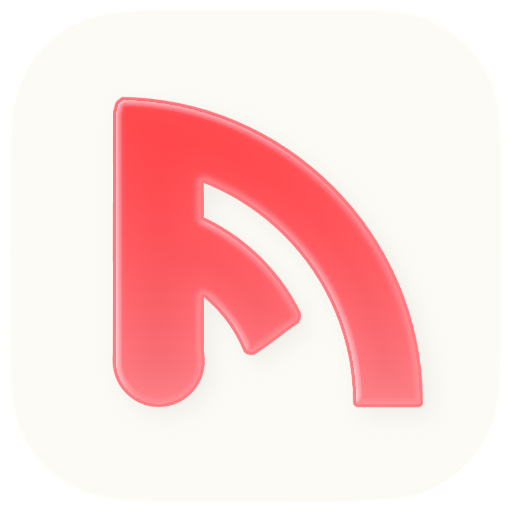
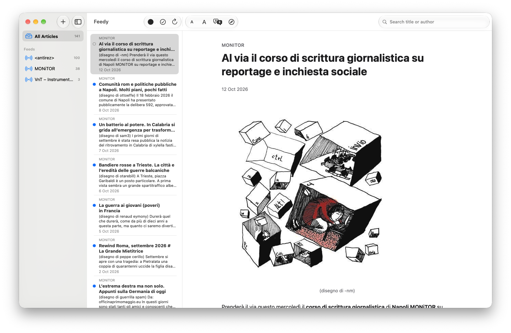
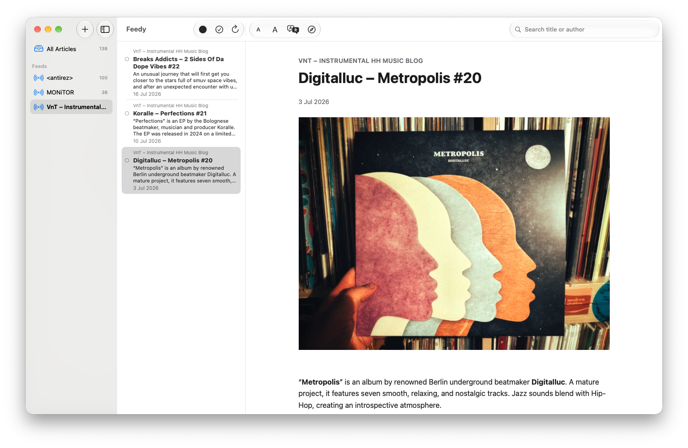
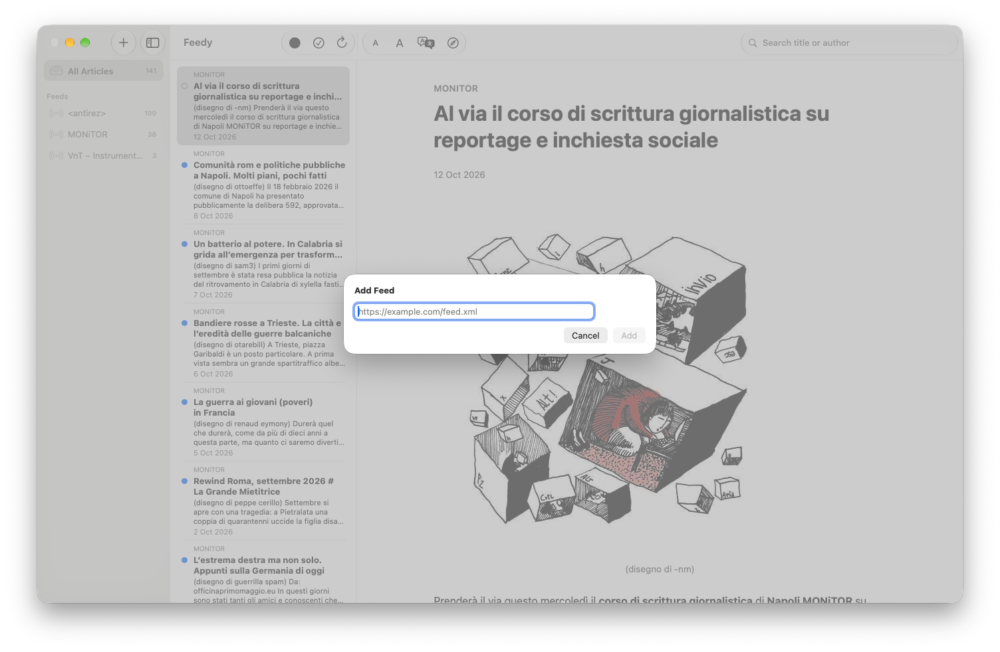

<p align="center">
  
</p>

<h1 align="center">Feedy</h1>

<p align="center">
  A small, native RSS reader for macOS. Free and open source.
</p>

<p align="center">
  
</p>

Feedy is a native macOS RSS reader with a three-column layout like Mail. Your feeds are on the left, the article list is in the middle (with read/unread state and search), and the selected article is on the right. Every article uses the same clean typography, whatever site it comes from.

## Features

- Subscribe to **RSS, Atom and JSON Feed** sources, and unsubscribe just as easily
- Refresh on launch or on demand (toolbar button or **⌘R**)
- Read/unread tracking, with a context menu to mark articles read or unread and to copy their link
- **Consistent article rendering:** one bundled stylesheet styles every article, and the HTML is sanitized (no scripts, iframes or inline handlers)
- Adjustable font size (toolbar **A− / A+**, **⌘+ / ⌘− / ⌘0**)
- **On-device translation** from English to Italian through Apple's `Translation` framework. Nothing is sent to third-party services.
- A health indicator for each feed that shows the last fetch error, if there was one
- Links open in your default browser

## Screenshots

| Reading a single feed | Adding a feed |
|---|---|
|  |  |

## Requirements

- macOS 15.0 or later
- Xcode 26 or later to build from source (the app icon is an Icon Composer `.icon` file)

## Installation

### Download

1. Download `Feedy-<version>.dmg` from the [latest release](https://github.com/davideluzi/feedy/releases/latest).
2. Open the `.dmg` and drag **Feedy** into **Applications**.
3. **First launch only:** Feedy isn't notarized by Apple yet, so macOS will block it the first time and say it can't verify the developer. To allow it:
   - Try to open Feedy once, then click **Done** in the warning.
   - Open **System Settings → Privacy & Security**, scroll down and click **Open Anyway** next to the message about Feedy.
   - Confirm with your password or Touch ID.

   After that, Feedy opens normally.

Feedy is a universal app and runs natively on both Apple Silicon and Intel Macs.

### Build from source

```bash
git clone https://github.com/davideluzi/feedy.git
cd feedy/Feedy
xcodebuild -scheme Feedy -destination 'platform=macOS' -configuration Release build
```

To copy the built app into `/Applications`:

```bash
ditto "$(xcodebuild -scheme Feedy -showBuildSettings -configuration Release 2>/dev/null | awk -F'= ' '/ BUILT_PRODUCTS_DIR /{print $2; exit}')/Feedy.app" /Applications/Feedy.app
```

You can also open `Feedy/Feedy.xcodeproj` in Xcode and press **⌘R**.

To build the same `.dmg` that's published in the releases (universal, ad-hoc signed, no Apple Developer account needed):

```bash
scripts/build-dmg.sh   # → build/Feedy-<version>.dmg
```

## Running the tests

```bash
cd Feedy
xcodebuild test -scheme Feedy -destination 'platform=macOS'
```

## Architecture

Feedy is built with Swift, SwiftUI, SwiftData and WKWebView, plus two dependencies: [FeedKit](https://github.com/nmdias/FeedKit) to parse feeds and [SwiftSoup](https://github.com/scinfu/SwiftSoup) to sanitize HTML.

The core idea is a **pure domain layer** (`Feedy/Feedy/Core/`) that sits behind protocols and doesn't depend on SwiftUI, SwiftData or the network. That's why feed parsing, HTML sanitization, article import and rendering can all be unit-tested without a UI or a network connection.

```
Feedy/
  Feedy/
    Models/      SwiftData entities (Feed, Article)
    Core/        Domain logic: parsing, sanitization, import, rendering, translation
    Views/       SwiftUI views (sidebar, article list, article detail, web view)
    Resources/   article.css, the single stylesheet used for every article
  FeedyTests/    Unit tests and fixtures (sample feeds, dirty HTML)
```

Some design choices worth mentioning:

- **Articles are sanitized once, when they're fetched.** The app stores clean HTML, not the raw feed HTML, and renders it in a single `WKWebView`.
- **Refreshing a feed never changes read state.** When an article is imported again, its content is updated but its read/unread flag is left alone.
- **A failed refresh never deletes anything.** It records the error on the feed (which drives the health indicator) and keeps the existing articles.
- **Only one file talks to FeedKit** (`FeedKitParser.swift`), so if the library changes, that's the only file to update.

More architectural notes are in [`CLAUDE.md`](CLAUDE.md).

## Roadmap

These are out of scope for v1 but may come later: full-text extraction for truncated feeds, feed auto-discovery from a website URL, folders, background refresh, full-text search, image caching and tracking-pixel blocking, favicons, and more translation languages.

## How it was built

I built Feedy with [Claude Code](https://claude.com/claude-code) as a pair programmer. We wrote a plan first, built it task by task with tests, and reviewed each step. The original plan and design specs are in [`docs/superpowers/`](docs/superpowers/).

## License

[MIT](LICENSE) © Davide Luzi
